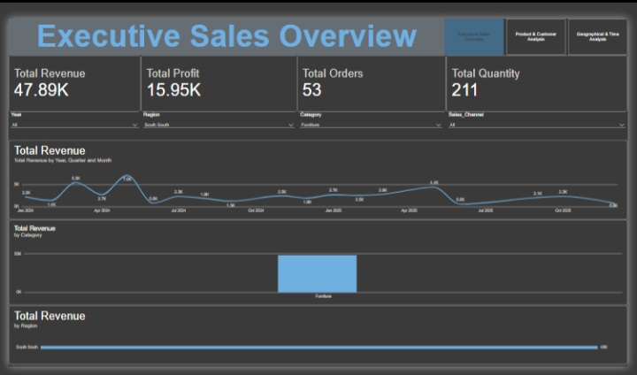
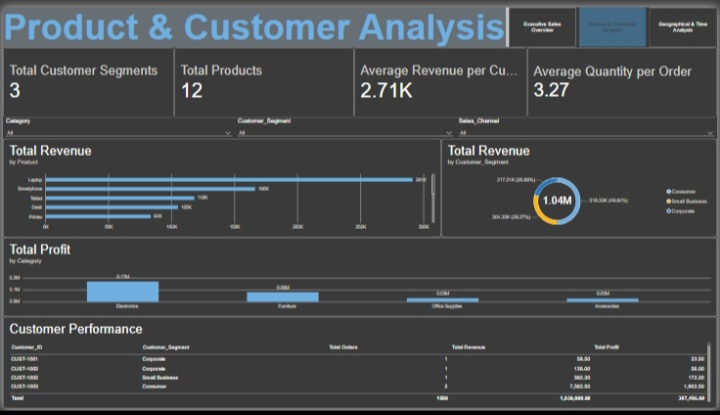
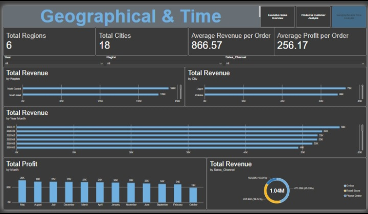

# Sales Performance Analytics Dashboard

An interactive Power BI portfolio project exploring sales performance across products, customers, regions, cities, sales channels, and time.

## Project overview

The report is organised into three pages:

1. **Executive Sales Overview** — headline revenue, profit, order and quantity KPIs; revenue trends; category and regional comparisons; and slicers for year, region, category, and sales channel.
2. **Product & Customer Analysis** — product revenue, customer-segment contribution, profit by category, customer-level performance, and supporting KPIs.
3. **Geographical & Time Analysis** — regional and city performance, monthly revenue and profit trends, sales-channel contribution, and supporting geographic/time KPIs.

## Tools and techniques

- Microsoft Power BI Desktop
- DAX measures
- Interactive slicers and report-page navigation
- KPI cards, line and column charts, bar charts, donut charts, and a customer detail table
- Sales analysis and business-focused data storytelling

## Key measures

The model includes measures for:

- Total Revenue
- Total Cost
- Total Profit
- Total Quantity
- Total Orders
- Total Customers
- Profit Margin
- Total Products and Categories
- Average Unit Price and Discount Rate
- Average Quantity per Order
- Average Revenue and Profit per Customer
- Total Regions and Cities
- Average Revenue and Profit per Order
- Revenue and Profit per Month

Example DAX:

```dax
Total Revenue = SUM(Sales_Data[Revenue])

Total Cost = SUM(Sales_Data[Cost])

Total Profit = SUM(Sales_Data[Profit])

Total Orders = DISTINCTCOUNT(Sales_Data[Order_ID])

Total Customers = DISTINCTCOUNT(Sales_Data[Customer_ID])

Profit Margin = DIVIDE([Total Profit], [Total Revenue], 0)

Average Revenue per Customer =
DIVIDE([Total Revenue], [Total Customers], 0)

Average Revenue per Order =
DIVIDE([Total Revenue], [Total Orders], 0)
```

Check the exact table and column names in the PBIX model before reusing these formulas. Measures respond to report filters and slicers; therefore, a KPI displayed on a filtered page is not necessarily the overall dataset total.

## Report screenshots

After the screenshots are added to this folder, they will appear here:

| Report page | Screenshot |
|---|---|
| Executive Sales Overview |  |
| Product & Customer Analysis |  |
| Geographical & Time Analysis |  |

## Project files

- `Sales_Performance_Analytics_Dashboard.pbix` — interactive Power BI report file (add this file to this folder).
- `screenshots/` — report-page preview images.

## Important interpretation notes

- KPI values depend on the active slicers and visual-level filters. Always check the filter context before presenting a value as a grand total.
- Revenue, cost, and profit definitions should be validated against the source dataset and business rules.
- Profit Margin should be formatted as a percentage in Power BI.
- Confirm that date fields sort chronologically and that slicers and page navigation work as intended.

## Limitations and transparency

This repository documentation describes the report structure and measures visible in the project. It does not claim that the dataset represents a real company or that the analysis reflects audited financial results. Add a dataset description and data-source attribution once those details are confirmed.

## Author

**Daniel Culsh**  
Aspiring Data Analyst | Business Administration | Power BI, Excel, Python, SQL, and AI Automation

This is a portfolio learning project and is not presented as professional client work.
